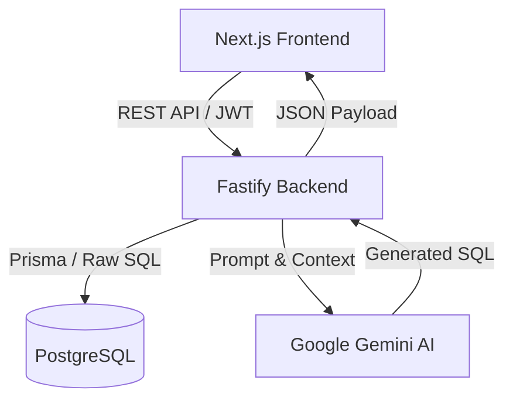

# 🏗️ RealOnes BI - System Architecture

This document provides a detailed overview of the decoupled architecture behind the **RealOnes BI** platform. The system is split into a robust backend API and a modern frontend UI, powered by a relational PostgreSQL database and the Google Gemini AI.

---

## 1. High-Level Architecture
RealOnes BI utilizes a decoupled **Client-Server** architecture:
* **Frontend (`realones-bi`)**: A Next.js web application that handles UI, charting, and user sessions.
* **Backend (`realones-bi-backend`)**: A Fastify Node.js server that handles authentication, database connections, data aggregations, and orchestrates the Gemini AI pipeline.
* **Database**: A PostgreSQL relational database managed via Prisma ORM, populated with real-world Kaggle datasets.
* **AI Engine**: Google Gemini (via `@google/genai`), responsible for converting natural language business questions into complex SQL queries.

---

## 2. Frontend Architecture (`realones-bi`)
**Tech Stack**: Next.js (App Router), React, Recharts, TailwindCSS (for utility), NextAuth.js.

### Core Responsibilities:
1. **User Interface**: Renders the "Premium Light Theme" Executive Dashboard and the "Ask RealOnes" chat interface.
2. **Session Management**: Uses `NextAuth.js` to handle login sessions. Instead of talking to the DB directly, NextAuth sends credentials to the Fastify backend's `/auth/login` route. Upon success, NextAuth stores the backend JWT inside the Next.js session cookie.
3. **API Proxying**: Next.js API routes (e.g., `src/app/api/dashboard/route.ts`) act as proxies. They intercept the frontend request, extract the JWT from the session cookie, and forward the request to `http://localhost:4000` (Fastify).
4. **Data Visualization**: Uses `Recharts` to render responsive Line Charts, Bar Charts, and KPI cards based on the JSON payloads returned by the backend.

---

## 3. Backend Architecture (`realones-bi-backend`)
**Tech Stack**: Fastify, TypeScript, Prisma ORM, JSON Web Tokens (JWT), `@google/genai`.

### Core Responsibilities:
1. **High-Performance API**: Built on Fastify (port 4000) to serve high-throughput analytical data rapidly.
2. **Authentication**: Uses `@fastify/jwt` to verify tokens on all protected routes using a `preValidation` hook (`server.authenticate`).
3. **Dashboard Aggregations**: The `/dashboard` routes execute raw SQL queries via `prisma.$queryRawUnsafe`. 
   * *Critical Architecture Note*: PostgreSQL `SUM()` and `COUNT()` aggregations natively return `Numeric` and `BigInt` types, which break JavaScript `JSON.stringify()`. The backend explicitly casts these in SQL using `::FLOAT` and `::INT` so the frontend receives standard JSON numbers.
4. **Role-Based Access Control (RBAC)**: All routes intercept the user's `regionScope` from the JWT and dynamically append `WHERE region IN (...)` to SQL queries, ensuring managers only see data they are authorized to see.

---

## 4. AI Orchestration Pipeline (`src/routes/query.ts`)
The true power of RealOnes BI is the **"Ask RealOnes"** orchestration pipeline. When a user asks a question (e.g., *"What is our most profitable product?"*), the backend executes a rigorous, multi-step pipeline:

1. **Context Assembly**: The backend gathers the user's question, their regional permissions, and the exact PostgreSQL database schema.
2. **Query Plan Generation**: The context is sent to `GeminiAIProvider`. Gemini acts as a Senior Data Analyst and generates a highly optimized SQL query.
3. **SQL Validation**: The backend intercepts the SQL and runs regex validations to ensure no destructive commands (`DROP`, `DELETE`, `UPDATE`) exist.
4. **Execution**: The backend safely executes the SQL against the PostgreSQL database using Prisma.
5. **Insight Generation**: The raw data rows are fed *back* to Gemini. Gemini analyzes the data and writes a human-readable business insight.
6. **Delivery**: The final payload (The SQL, the raw data rows, and the English insight) is sent back to the Next.js frontend to be rendered in the results table.

---

## 5. Database Architecture (PostgreSQL + Prisma)
The schema (`prisma/schema.prisma`) represents a standard relational e-commerce / retail system.
* **`users`**: Contains credentials, roles (`ADMIN`, `ANALYST`), and linked `regions` for data masking.
* **`regions`**: Geographic territories (e.g., "West", "East").
* **`customers`**: The client database.
* **`products` & `product_categories`**: Inventory metadata.
* **`orders` & `order_items`**: Transactional fact tables containing `quantity` and `unitPrice`.

**Data Ingestion (`prisma/import-kaggle.ts`)**:
The system includes a dedicated ETL (Extract, Transform, Load) script. It parses raw CSV files (like the Kaggle Superstore dataset), normalizes the string dates into JavaScript `Date` objects, looks up relational IDs, and batch-inserts the records into PostgreSQL using Prisma.
