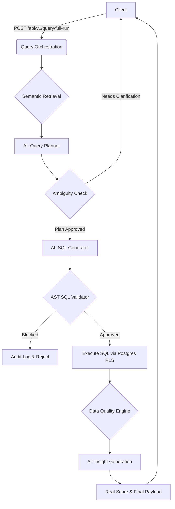

# RealOnes BI Backend

RealOnes BI is a governed, explainable AI-powered Business Intelligence platform. This project provides a standalone, production-ready Fastify + PostgreSQL backend that safely converts natural language questions into validated, read-only SQL queries.

## Core Objective
"Real Data, Real Metrics, Real Decisions."

## Architecture

This backend is built to completely separate natural language interpretation from SQL execution safety.



## Features
- **Semantic Layer**: Pre-approved metrics, dimensions, and join paths restrict AI hallucinations.
- **AST Validator**: Uses `node-sql-parser` to ensure the generated SQL is absolutely safe, read-only, and accesses only approved schemas.
- **PostgreSQL RLS**: Enforces Row-Level Security at the database tier. Business Users are locked to their authorized regions.
- **Data Vibe & Real Score**: Deterministically calculates confidence based on schema matching, execution success, and data quality (missing values, nulls).
- **Audit Trails & Decision Receipts**: Every AI interaction, blocked query, and business decision is logged in PostgreSQL.

## Getting Started

### Prerequisites
- Node.js 22+
- Docker and Docker Compose

### 1. Environment Setup
```bash
cp .env.example .env
```
Ensure `DATABASE_URL` is set to your Postgres instance.

### 2. Start PostgreSQL
```bash
docker-compose up -d
```

### 3. Database Setup (Prisma)
```bash
npx prisma generate
npx prisma db push
# Seed the database (assumes seed script is in prisma/seed.ts)
npx prisma db seed
```

### 4. Run the Server
```bash
npm run dev
```
The API runs at `http://localhost:4000`.
Swagger docs are available at `http://localhost:4000/docs`.

## Security Model
- **SQL Parsing**: All AI-generated SQL is parsed into an Abstract Syntax Tree (AST) before execution. If the AST contains `DELETE`, `UPDATE`, comments, multiple statements, or touches unauthorized tables (like system catalogs), the query is blocked immediately.
- **RLS**: Queries are executed inside a read-only transaction, setting the user's role and ID in the session context so PostgreSQL RLS policies automatically filter rows.
- **PII Scrubbing**: PII columns are explicitly blocked in the AST validator.

## API Documentation
The primary orchestration endpoint is `/api/v1/query/full-run`. Check `/docs` for full Swagger documentation.

## Known Limitations
- Synthetic demo data only.
- The deterministic Real Score is not a guarantee of truth.
- Diagnostic analysis does not prove causality.
- The mock AI provider is development-only. Production needs an OpenAI/Anthropic provider configured.
